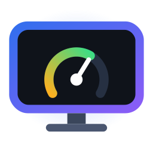

  

<h1 align="center">TV Otimizador</h1>

  Análise e otimização de <b>Android TV / Google TV</b> pelo Windows, via ADB na rede. 
  Descubra o que deixa sua TV lenta, desative o que não usa e acompanhe a tela dela do computador.

---

## O que ele faz

- **Diagnóstico com nota de saúde (0–100)**: memória livre, uso da zram (swap), travadas por falta de memória (reclaim direto), carga do sistema, CPU, armazenamento, cache dos apps e tempo ligada.
- **Recomendações com um clique**: lista agrupada (TCL, Google, Sistema, Apps de streaming…) com risco, RAM e cache de cada item. Você marca o que quer e clica em **Aplicar**.
- **Tudo é reversível**: os apps são só *desativados* (`pm disable-user`), nunca desinstalados. Itens já aplicados aparecem em cinza com botão **Restaurar**, e há o **Reverter tudo**.
- **Tela inicial**: troca o launcher pesado do Google pelo Projectivy, FLauncher ou ATV Launcher (instala pela Play Store da TV) e volta quando quiser.
- **Tela da TV**: veja a tela da TV numa janela no PC e controle com setas, OK, Voltar, Home e volume (botões ou teclado). Ou abra o **scrcpy** para tela ao vivo com mouse e teclado.
- **Instala as próprias dependências**: a aba **Configurações** baixa o ADB (Google) e o scrcpy (GitHub) para a pasta que você escolher.
- Aba de **processos**, **diagnóstico completo** em texto e **exportação de relatório**.

## Requisitos

- Windows 10 ou 11 (usa o Windows PowerShell 5.1, que já vem no sistema).
- TV com Android TV / Google TV na mesma rede do PC.
- **Depuração ativada na TV**:
  1. *Configurações > Sistema > Sobre* (ou *Preferências do dispositivo > Sobre*): clique 7 vezes em **Versão/Build** até aparecer "Você é um desenvolvedor".
  2. *Opções do desenvolvedor*: ative **Depuração USB** e, se existir, **Depuração de rede/ADB**.
  3. Anote o IP da TV em *Configurações > Rede > Status*.

## Como usar

1. Baixe o `.zip` da última versão em [Releases](https://github.com/ajcorrea/tv-otimizador/releases) e extraia numa pasta.
2. Dê dois cliques em **`TV-Otimizador.cmd`**.
3. No primeiro uso, a aba **Configurações** abre sozinha: clique em **Baixar e instalar** no item ADB.
4. Digite o IP da TV e clique em **Conectar e analisar**. Na TV, aceite **Permitir depuração** (marque *Sempre permitir*).
5. Revise as recomendações (os itens com ★ são sugeridos) e clique em **Aplicar alterações**.

> Se o Windows bloquear o script, clique com o botão direito no `TV-Otimizador.ps1` > *Propriedades* > marque **Desbloquear**.

## Onde ficam os dados

`%APPDATA%\TV-Otimizador\`
- `config.json`: IP/porta da TV e caminhos do ADB e do scrcpy.
- `historico.json`: o que o app alterou na TV (usado pelo **Reverter tudo**).

## Compatibilidade

Desenvolvido e testado numa TCL com Android TV 11 (Realtek RTD2851A, 2 GB). O catálogo de recomendações tem descrições para apps da **TCL**, do **Google** e de streaming. Em outras marcas a análise funciona normalmente, e os apps sem descrição aparecem em "Outros pacotes do sistema", marcados como risco alto.

Quer adicionar descrições para apps de outras marcas com Android TV (Philips, Sony, Xiaomi...)? Edite o `$script:Catalogo` no início do script e mande um Pull Request.

## Versionamento

- Versão em [SemVer](https://semver.org/lang/pt-BR/) no arquivo `VERSION` e no script; build `AAAAMMDD.N` a cada compilação.
- `tools\bump-version.ps1 -Parte patch|minor|major -Nota "..."` atualiza versão, build e `CHANGELOG.md`.
- A cada push na `main`, o GitHub Actions valida o script (sintaxe e todos os XAML no Windows). Se a versão do `VERSION` ainda não foi publicada, ele cria a tag `v<versão>` e a Release com o `.zip` e as notas do CHANGELOG.

## Aviso

Use por sua conta e risco. O app só usa comandos reversíveis do Android, mas desativar componentes do sistema pode mudar funções da TV. Na dúvida, use **Restaurar** ou **Reverter tudo**.

## Autor

**Alexandre Jeronimo Correa**
- E-mail: [ajcorrea@gmail.com](mailto:ajcorrea@gmail.com)
- GitHub: [github.com/ajcorrea](https://github.com/ajcorrea)

## Licença

[MIT](LICENSE): livre para usar, modificar e distribuir.
